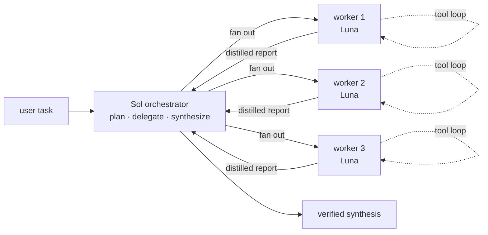

# Orchestrator

Keep the primary agent focused on decomposition, judgment, coordination,
verification, and final synthesis. Move noisy exploration, implementation,
tests, logs, and supporting research into isolated subagent contexts.

## Architecture

Use this topology for every delegated workflow that is large enough to justify
delegation:



The intended topology is one Sol primary orchestrator and exactly three
independent workers. Workers are bounded, do not spawn recursively, and return
structured evidence rather than raw transcripts.

## Model and execution routes

### Model contract

- Primary orchestrator: `gpt-5.6-sol` with `xhigh` reasoning.
- Preferred exact worker model: `gpt-5.6-luna` with `xhigh` reasoning.
- Visible native fallback worker: `gpt-5.6-terra` with `xhigh` reasoning only
  when sidebar visibility is requested and native Luna is rejected.
- Run exactly three workers concurrently for a delegated workflow.

The skill cannot change the model of an already-running primary task. Launch the
next orchestrated task with `gpt-5.6-sol`/`xhigh`, and state the actual primary
model when the host cannot honor that contract. Do not claim that the current
task is Sol merely because this skill was loaded.

### Route selection

1. If the user asks to see live activity, sidebar workers, or a sub-agent
   section, use **Sidebar-visible native mode**.
2. Otherwise use **Luna CLI mode** to guarantee exact Luna/xhigh workers.
3. Never claim that CLI workers are visible in the sidebar, and never label a
   Terra fallback as Luna.

### Sidebar-visible native mode

Use the native collaboration/sub-agent mechanism (`spawn_agent`) for each
independent worker. Native workers are the only route that exposes live status
and tool activity in the app's sub-agent section.

- Attempt `gpt-5.6-luna` with `xhigh` only if the native router accepts it.
- If native Luna is rejected and sidebar visibility is the user's priority,
  use `gpt-5.6-terra` with `xhigh` and explicitly report that fallback.
- If exact Luna execution is mandatory, use Luna CLI mode and disclose that
  the workers will not appear in the sidebar.
- Keep native worker prompts bounded, disjoint, and non-recursive. Use the
  collaboration wait/status mechanism until every required worker finishes.

### Luna CLI mode

Use the bundled `scripts/run-luna-workers.mjs` runner when exact Luna/xhigh
execution is required or the user did not request sidebar visibility. The
runner launches separate `codex exec` processes, pins workers to
`gpt-5.6-luna`/`xhigh`, disables recursive agents, validates a structured report,
and returns one aggregate JSON result. This route is not sidebar-visible.

- The runner is a control-plane process: it creates ephemeral temp files and
  optional trace artifacts. Run the control plane with a sandbox that permits
  those files, while keeping each read-only worker at `--sandbox read-only`.
  Never describe this as zero-write execution. Codex CLI also needs an
  authenticated writable runtime home for state; pass `--codex-home` when the
  default home is not writable. Repository access remains read-only.
- Use `read-only` for exploration, review, research, logs, and test inspection.
  Use `workspace-write` only for implementation tasks with disjoint ownership
  and explicit authorization.
- Run dependent or overlapping tasks in separate sequential runner invocations.

## Worker Spec

Write a temporary JSON spec outside committed project files:

```json
{
  "tasks": [
    {
      "id": "surface-a",
      "prompt": "Inspect surface A. Return only the required structured report.",
      "sandbox": "read-only"
    },
    {
      "id": "surface-b",
      "prompt": "Inspect surface B. Return only the required structured report.",
      "sandbox": "read-only"
    },
    {
      "id": "surface-c",
      "prompt": "Inspect surface C. Return only the required structured report.",
      "sandbox": "read-only"
    }
  ]
}
```

Create exactly three meaningful, independent slices; never add filler work just
to reach the count. Give write workers disjoint files or components. Include all
task-local context, success criteria, evidence requirements, and scope boundaries
in each prompt. Each worker must return JSON with `status`, `summary`, `files`,
`verification`, and `risks` fields.

Run the workers from the target repository directory:

```bash
node "${CODEX_HOME:-$HOME/.codex}/skills/orchestrator/scripts/run-luna-workers.mjs" \
  --spec /absolute/path/to/tasks.json \
  --cwd /absolute/path/to/repository \
  --max-concurrency 3 \
  --trace-dir /absolute/path/to/temporary/traces \
  --codex-home /absolute/path/to/authenticated/writable/codex-home
```

The command requires network access for Codex model calls. If the sandbox blocks
the control-plane temp directory, change the control-plane sandbox rather than
silently claiming success. Parse the returned JSON and treat any `ok: false`
result, malformed worker report, or timeout as a failed worker. When
`--trace-dir` is supplied, a missing trace is also a failure.

## Workflow

1. Assess whether delegation is worthwhile. Continue in the primary thread when
   the task is small, sequential, or cannot be divided into three meaningful
   independent slices.
2. Decompose larger work into exactly three concrete tasks with clear scope,
   dependencies, ownership, expected evidence, and completion criteria.
3. Select Sidebar-visible native mode when the user asks to watch activity;
   otherwise select Luna CLI mode for exact Luna/xhigh execution.
4. Launch all three selected workers in parallel. Do not silently reduce the
   count or add filler tasks.
5. Give each worker only the context it needs and require the structured report.
6. Wait for all three workers. Inspect every report and trace, reconcile
   contradictions, verify important claims, and run final integration checks.

## Coordination Rules

- Parallelize exactly three read-heavy tasks when they are independent.
- Give parallel write workers disjoint files or components.
- Run dependent or overlapping write tasks sequentially through follow-up
  delegations.
- In sidebar-visible mode, keep native workers running until their live status
  is complete and give the user concise progress updates in the primary task.
- Preserve user changes and shared-workspace state.
- Do not let workers broaden scope or perform unrelated external actions.
- Reuse worker evidence instead of repeating repository-wide scans in the
  primary thread.
- Stop before delegation when three meaningful independent tasks do not exist;
  do not manufacture work to satisfy the topology.
- Report one verified synthesis to the user, not a transcript of worker
  activity.
