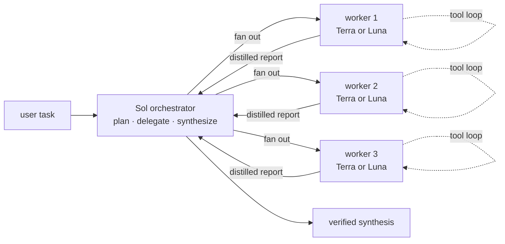

# Orchestrator

Keep the primary agent focused on decomposition, judgment, coordination,
verification, and final synthesis. Move noisy exploration, implementation,
tests, logs, and supporting research into isolated subagent contexts.

## Architecture

Use this topology for every delegated workflow:



The primary agent is the Sol orchestrator. Workers are bounded, do not spawn
recursively, and return evidence rather than raw transcripts.

## Model and execution routes

### Model contract

- Primary orchestrator: `gpt-5.6-sol` with `xhigh` reasoning.
- Preferred exact worker model: `gpt-5.6-luna` with `xhigh` reasoning.
- Visible native fallback worker: `gpt-5.6-terra` with `xhigh` reasoning when the
  native router does not accept Luna.
- Run no more than four workers concurrently.

The skill cannot change the model of an already-running primary task. Treat the
model contract as the required setting for the next orchestrated task and state
the actual model when the host cannot honor it.

### Route selection

1. If the user asks to see live activity, sidebar workers, or a sub-agent
   section, use **Sidebar-visible native mode**.
2. Otherwise use **Luna CLI mode** when exact Luna xhigh execution is valuable.
3. Never claim that CLI workers are visible in the sidebar, and never label a
   Terra fallback as Luna.

### Sidebar-visible native mode

Use the native collaboration/sub-agent mechanism (`spawn_agent`) for each
independent worker. Native workers are the only route that exposes live status
and tool activity in the app's sub-agent section.

- Attempt `gpt-5.6-luna` with `xhigh` only if the native router accepts it.
- If native Luna is rejected and sidebar visibility is the user's priority,
  use `gpt-5.6-terra` with `xhigh` and explicitly report that fallback.
- If exact Luna execution is mandatory, use Luna CLI mode and disclose that
  the workers will not appear in the sidebar.
- Keep native worker prompts bounded, disjoint, and non-recursive. Use the
  collaboration wait/status mechanism until every required worker finishes.

### Luna CLI mode

Use the bundled `scripts/run-luna-workers.mjs` runner when exact Luna xhigh
execution is required or the user did not request sidebar visibility. The
runner launches detached `codex exec` processes, pins workers to
`gpt-5.6-luna`/`xhigh`, disables recursive agents, and returns one aggregate
JSON result. This route is not sidebar-visible.

- Use `read-only` for exploration, review, research, logs, and test inspection.
  Use `workspace-write` only for implementation tasks with disjoint ownership.
- Run dependent or overlapping tasks in separate sequential runner invocations.
- Bound each CLI invocation with a host-level timeout and monitor the runner and
  child processes. If it exceeds the timeout, terminate it and classify the
  affected workers as incomplete; do not synthesize missing reports.
- On a timeout or failed aggregate result, retry once with fewer workers or use
  the documented native Terra fallback when exact Luna execution is unavailable.
  Report the actual route, model, failed worker IDs, and remaining evidence gap.

## Worker Spec

Write a temporary JSON spec outside committed project files:

```json
{
  "tasks": [
    {
      "id": "tests",
      "prompt": "Inspect the test suite for important coverage gaps. Return evidence and risks.",
      "sandbox": "read-only"
    },
    {
      "id": "implementation",
      "prompt": "Implement the assigned change only in src/component-a. Run focused verification.",
      "sandbox": "workspace-write"
    }
  ]
}
```

Give write workers disjoint files or components. Include all task-local context,
success criteria, evidence requirements, and scope boundaries in each prompt.
Require each worker's final message to name findings or changes, files inspected
or modified, commands/tests run, evidence, and remaining risks.

Run the workers from the target repository directory:

```bash
node /absolute/path/to/orchestrator/scripts/run-luna-workers.mjs \
  --spec /absolute/path/to/tasks.json \
  --cwd /absolute/path/to/repository \
  --max-concurrency 4
```

The command requires network access for Codex model calls. If the sandbox blocks
the request, retry it through the normal scoped approval flow. Parse the returned
JSON and treat any `ok: false` result as a failed worker, not as partial success.

## Workflow

1. Assess whether delegation is worthwhile. Continue in the primary thread when
   the task is small, sequential, or likely to cost more coordination than it
   saves.
2. Decompose larger work into concrete tasks with clear scope, dependencies,
   ownership, expected evidence, and completion criteria.
3. Select Sidebar-visible native mode when the user asks to watch activity;
   otherwise select Luna CLI mode when exact Luna execution is needed.
4. Launch the selected workers in parallel only when tasks are independent and
   use no more than four concurrent workers.
5. Give each worker only the context it needs. Require a distilled result:
   findings or changes, files inspected or modified, commands/tests run,
   evidence, and remaining risks. Do not request raw logs or large file dumps.
6. Wait for every required worker. Inspect each result, reconcile
   contradictions, verify important claims, and run any final integration
   checks needed before answering.

## Coordination Rules

- Parallelize read-heavy work when tasks are independent.
- Give parallel write workers disjoint files or components.
- Run dependent or overlapping write tasks sequentially through follow-up
  delegations.
- In sidebar-visible mode, keep native workers running until their live status
  is complete and give the user concise progress updates in the primary task.
- Preserve user changes and shared-workspace state.
- Do not let workers broaden scope or perform unrelated external actions.
- Reuse worker evidence instead of repeating repository-wide scans in the
  primary thread.
- Stop spawning workers once additional delegation would not improve latency,
  quality, context isolation, or expensive-model usage.
- Report one verified synthesis to the user, not a transcript of worker
  activity.
